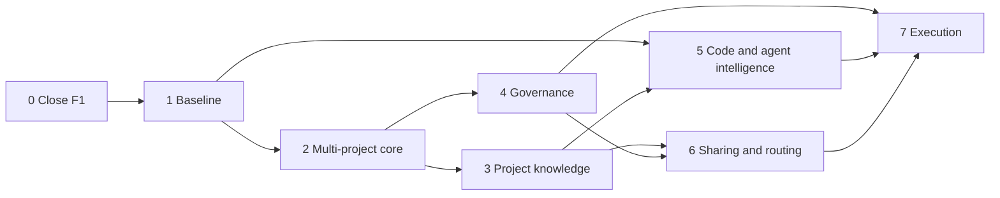

# Roadmap: orchestrator → meta-harness

Status: proposal, not approved (2026-11-06). Inputs: [audit.md](audit.md), [architecture.md](architecture.md).
Each task becomes an `odd/tasks/` file (or a small-task brief) when the user starts it; nothing here is in flight.

The meta-harness is this repository evolved, not a new project (user, 2026-11-06): the orchestrator template
keeps working at every step and becomes the meta-harness phase by phase, a little at a time.

## 1. How the phases work

- **One phase = one release.** Each phase ends in a version that is useful on its own. If the project stopped
  after any phase, what shipped still works and nothing half-built is left in the template.
- **Entry conditions and an exit gate.** A phase starts only when its entry conditions hold and its decisions
  are taken. It ends only when every exit criterion has evidence (a test, a command, a report). A criterion that
  can't be verified keeps the phase open; it is never ticked on trust.
- **Measured against the baseline.** From phase 1 on, every feature that claims to save tokens or time is
  compared with the phase-1 baseline. A feature that doesn't beat it stays opt-in or is dropped. This is how
  the meta-harness avoids spending more on coordinating than it saves.
- **Deterministic before model, read before write, one project before many, policy before execution.** The order
  below follows these four rules.
- **Work inside a phase** can run in parallel when it has no dependency; across phases, only the tasks marked
  *early start* (no dependencies, no shipped behaviour until their phase).

## 2. Phases at a glance

| Phase | Name | Release | Brief | Gate in one line |
|---|---|---|---|---|
| 0 | Close F1 | v0.8.0 | F1 + session memory | telemetry and session handoff live on one real workspace |
| 1 | Baseline | v0.8.x | F1, F3 (data) | we know where the tokens go, with a valid sample |
| 2 | Multi-project core | v0.9.0 | Meta-Harness Core, Harness Abstraction, Projects | two projects registered, isolated, seen together read-only |
| 3 | Project knowledge | v0.10.0 | Knowledge Platform (project scope) | knowledge exported and queried with no net token increase |
| 4 | Governance | v0.11.0 | F4 | a policy floor no project can loosen, compiled into each runtime |
| 5 | Code and agent intelligence | v0.12.0 | F2, F3 | each feature beats the baseline or stays opt-in |
| 6 | Sharing and routing | v0.13.0 | Knowledge (shared/global), F5 routing | knowledge shared under policy; routing recommends, never acts |
| 7 | Meta-harness execution | v1.0.0 | F5 | opt-in dispatch, recovery and safe parallelism, measured |

Phases 3 and 4 can run in parallel after phase 2. Phase 5 needs the baseline (1) and uses project knowledge (3).
Phase 7 needs governance (4) before any dispatch.

### Why this order and not the brief's

- **Baseline before building.** F2, F3 and F5 all claim to save tokens; with zero real rows we can't tell where
  tokens go. Phases 0–1 make every later decision evidence-driven.
- **Project/harness core before knowledge.** Knowledge scopes need a project id and a registry first.
- **Native OKF v0.2 before llm-wiki.** llm-wiki has no licence and targets OKF v0.1 (architecture §3.2).
- **Governance before anything crosses a project boundary or runs unattended** (phases 6 and 7), as the brief asks.
- **F2 and F3 together, after the baseline**: both are "pick better context / pick a better agent", both are
  judged by the same benchmark, and the data decides which gets built first.

## 3. Phases

Complexity: S (≤ 1 day), M (2–4 days), L (≥ 1 week). Token impact = what the feature adds to a normal session
once shipped.

### Phase 0 · Close F1 → v0.8.0

- **Goal**: what F1 built is released, documented and running on one real workspace, and a session's state
  survives even when the model doesn't save it.
- **Entry**: now. **Decisions before starting**: D1 (rename scope, the release's install URL depends on it),
  D9 (docs language). **Needed from the user**: the original F1-01…F1-14 texts, if they live outside the repo.
- **Exit gate**:
  - every event type and key in `telemetry.py` is in the contract doc, checked by a test;
  - every F1-xx criterion is traceable to a test or a recorded manual check;
  - phase-1 review findings fixed or accepted; smoke and unit tests green on 3 OSes;
  - v0.8.0 released; one workspace updated with its user files unchanged; one live session shows main and agent
    usage with coverage, and the deferred `SubagentStart`/`PostToolUseFailure` payload check is done;
  - S1's five criteria pass, including one real session ended without `sync-memory`.
- **Out of scope**: anything multi-project, knowledge, policy.

**R1 · Telemetry contract document and F1 spec in the repo** · S · deps: —
- `docs/telemetry.md`: event types, keys, statuses, sources, schema and migrations, privacy rules, parser
  versioning, F1-01…F1-14 with the test that proves each. Four (06, 07, 11, 12) are cited by no test today.
- Criteria: a test compares the doc with the contract in code; each F1-xx has a test or "verified by hand: <how>".
- Tokens: 0.

**R2 · Global vs project metrics: decision** · S · deps: R1
- All metrics stay in each project's store; a global view may only read registered stores (phase 2). No global
  store. Recorded in R1's doc. Tokens: 0.

**R3 · Phase-1 review** · M · deps: R1
- Privacy (`errors.log` content, `transcript_path` retention), hook latency (`ingest_log` p95 < 100 ms),
  failure isolation, update path v0.7.0 → current. Findings fixed in their own PRs or accepted.

**S1 · Automatic session handoff** · M · deps: — (asked by the user 2026-11-06)
- Today `memory/` survives a session only if the orchestrator runs `sync-memory`. S1 adds a deterministic
  draft of where the work stopped, shown at the next start only when the session didn't sync.
- At `SessionEnd` (Claude Code), `session-handoff.py` writes `.orchestrator/state/handoff.md` (git-ignored,
  overwritten): session id and end time; per repo the branch, uncommitted files (count, capped paths) and
  commits ahead of `origin/<base>`; each active `odd/tasks/*.md` with its `Next:` and tasks not `done`; agent
  runs started and never finished (telemetry, when present); whether `memory/` changed during the session.
- A session killed without `SessionEnd` is caught at the next `SessionStart`, as the main-session usage is today.
- At `SessionStart`, only if the last session didn't update `memory/`: the draft as context (≤ ~150 words) and
  one instruction, offer to reconcile it through `sync-memory`.
- Git local only (no `gh`, no network), no file contents, prompts or diffs; never writes `memory/`. Codex: the
  start-side recovery works; its end event is used once its payload is verified.
- Files: `templates/orchestrator/scripts/session-handoff.py`, `hooks/session-memory.sh`,
  `templates/claude/settings.json`, `templates/gitignore`, one sentence in `AGENTS.md`, `update.py` rules, tests.
- Criteria: O1 an unsynced session leaves a draft naming dirty branches, active task files and unfinished runs ·
  O2 shown at the next start, nothing after a synced session · O3 a killed session is recovered · O4 no contents,
  prompts, diffs or secrets · O5 no network or model, never blocks, < 200 ms on the smoke workspace.
- Tokens: 0 after a synced session; ≤ ~200 after an unsynced one (instead of a rebuild from git).

**X3 · Rename follow-through** · S · deps: D1
- README, INSTALL, update notice and release notes point to `telmoDev/hat`. Recommended: keep paths
  (`.orchestrator/`, `orchestrator.conf`, skill `orchestrator-setup`) because every workspace has them.

**R4 · Release v0.8.0 and update one real workspace** · S · deps: R3, S1, X3
- `release.sh 0.8.0` after the user merges; `scripts/update.sh` on the workspace the user picks, on their go,
  from a clean `git status`; one live session for the payload check.

### Phase 1 · Baseline → v0.8.x (fixes only)

- **Goal**: know where tokens and time go in real work, and have a valid benchmark sample.
- **Entry**: phase 0 gate passed. **Decisions**: the model and the go for benchmark runs (they spend quota).
- **Exit gate**:
  - two weeks of normal work on the updated workspace and one `metrics` report: main vs agent tokens, by agent
    type and task size, coverage, attempts, criteria pass rate, instrumentation overhead;
  - B1–B5 on the current hashes, both flows, n = 3 a side, versioned; `telemetry.py benchmark` reading;
  - a one-page baseline in `docs/meta-harness/baseline.md` and a recommendation on which of phase 5's tracks
    to build first (D7).
- **Early start allowed** during the two weeks: X2 and K1 (no shipped behaviour until their phase).

**R5 · Field data and baseline report** · S (mostly waiting) · deps: R4 · Tokens: instrumentation only.
**R6 · Benchmark, valid sample** · S, quota-bound · deps: R4.

### Phase 2 · Multi-project core → v0.9.0

- **Goal**: the meta-harness knows which projects exist, which harnesses each can use and what they can do,
  without any project depending on another.
- **Entry**: phase 1 gate. **Decisions**: D5 (global location `~/.hat/`).
- **Exit gate**: two scaffolded workspaces registered and shown apart; an unregistered one is never read; no file
  under any project is written by the global view; every existing telemetry test passes unchanged behind the
  harness contract; `hat doctor` lists each runtime's verified capabilities; a workspace without `~/.hat/` works
  exactly as before (smoke).

**X1 · Project registry and read-only global view** · M · deps: R2
- `~/.hat/projects.toml` (id, root, repos, harnesses); `hat project add|list|remove`; `hat status` reads each
  registered store read-only (tasks in flight, last runs, usage); a missing root is reported, not fatal.
- Files: `scripts/hat.py`, read-only open in `telemetry.py`, tests. Tokens: 0.

**X2 · Harness capability contract; Claude adapter behind it** · M · deps: — (early start)
- `capabilities()` + `health_check()` per adapter; Claude moved behind it with no behaviour change; a Codex stub
  declaring only what is verified (SessionStart hooks, `usage: unavailable`).
- Files: `templates/orchestrator/scripts/adapters/`, `telemetry.py`. Tokens: 0.

**M1 · Cross-project in-flight view and dependency check** · S · deps: X1
- `hat status` adds task-file dependencies across projects: cycles, blocked tasks, stale *Resume* items.

### Phase 3 · Project knowledge → v0.10.0

- **Goal**: each project's decisions and finished features become an OKF v0.2 bundle that the ODD flow can query,
  built without a model, and the flow doesn't get more expensive.
- **Entry**: phase 2 gate. **Decisions**: D2 (llm-wiki), D3 (OKF v0.2), D4 (YAML parsing).
- **Exit gate**: the spec's v0.2 examples validate, v0.1 with legacy warnings, unknown keys preserved; export is
  incremental (no change → no write; one decision changed → one concept); nothing failing the secret check is
  exported; on the phase-1 workspace, tokens per large task don't rise against the baseline, with the share of
  queries that fed a plan reported.

**K1 · Native OKF v0.2 validator and indexer** · M · deps: — (early start)
- `knowledge.py validate|index`: OKF §11 conformance plus our rules (actors, ISO timestamps with offset,
  `x_scope`, secret patterns from `memory-check.py`). Stdlib; PyYAML only if present (D4). Tokens: 0.

**K2 · Deterministic export** · M · deps: K1, X1
- `knowledge.py export` → `knowledge/` from `memory/DECISIONS.md` and `odd/tasks/*` with `Status: done`;
  `sources` point at the originals; `generated.by: hat/<version>`; `verified` only with a human sign-off in the
  source. Tokens: 0.

**K3 · Query and ODD wiring** · S · deps: K2
- `knowledge.py query <terms>` (navigation + grep, path and description); `AGENTS.md` step 1 queries before a
  large plan; export runs when a task file reaches `done`. Tokens: + ~200–500 per large task, 0 for small ones.

**K4 · llm-wiki evaluation spike (optional)** · S · deps: K1, D2
- On a throwaway copy, cross-run the two validators; report what interoperates. No code copied.

### Phase 4 · Governance → v0.11.0

- **Goal**: one policy floor for every project and runtime, enforced by each runtime's own mechanism, before
  anything crosses a project boundary or runs unattended.
- **Entry**: phase 2 gate (needs the registry). Can run in parallel with phase 3.
- **Exit gate**: a project cannot loosen a global deny (test); compiled settings keep the user's own entries
  (update rules); smoke covers a denied path outside the workspace and an `ask` on a destructive command;
  budget warnings appear at the configured ceiling and never stop a session.

**G1 · Policy floor compiled to Claude permissions** · M · deps: X1
- `~/.hat/policy.toml` + project overrides that only tighten → `.claude/settings.json` `permissions` (deny paths
  outside the workspace, ask for destructive commands, MCP allowlist per project); secret rules on export.
**G2 · Codex policy compilation** · M · deps: G1, D6 (Codex installed); otherwise carried to phase 7.
**G3 · Budget warnings** · S · deps: R5 (realistic ceilings) · one line to the orchestrator when hit.

### Phase 5 · Code and agent intelligence → v0.12.0

- **Goal**: better context and better agent/model choice, each proven against the baseline.
- **Entry**: phase 1 gate (baseline), phase 3 (knowledge to link code to decisions). **Decisions**: D7 (which
  track first and whether F2 is built at all, from the baseline).
- **Exit gate**: each shipped feature has an A/B with n ≥ 3 showing quality holds and total tokens drop, or it
  ships opt-in; the recommendation table never prints a direction below n = 3.

**C1 · Symbol and import index** · M · deps: D7 gate
- `.orchestrator/index/<repo>.sqlite`, incremental by `git diff` since the last indexed commit; Python via
  `ast`, others via `universal-ctags` when installed. No vectors. Tokens: 0 to build.
**C2 · Queries `where|refs|impact|context`** · M · deps: C1 · Tokens: replaces explorer runs when it hits.
**C3 · A/B on B1 and B3** · S, quota · deps: C2, R6.
**A1 · Recommendation table** · M · deps: R5, R6
- `telemetry.py recommend`: per task type, tier vs quality, cost, consumption and coverage as separate columns,
  n beside each. Evidence for the user to change tiers; never rewires them. Tokens: 0.

### Phase 6 · Sharing and routing → v0.13.0

- **Goal**: knowledge moves between projects only when allowed, with its provenance; the meta-harness can say
  which harness fits a task.
- **Entry**: phases 3 and 4.
- **Exit gate**: a concept reaches a share only from a project that exports to it and only into projects that
  import it (tests); provenance (`sources`, `x_origin_project`, `verified`, `generated`) survives the sync;
  sharing grants no file, tool or telemetry access; routing output is a recommendation only.

**K5 · Shares and global knowledge** · M · deps: K2, G1
- `knowledge.py sync` → `~/.hat/knowledge/shared/<share>/`; global bundle read-only for every project.
**M2 · Routing recommendation** · S · deps: X2, G1 · harness by capabilities and policy.

### Phase 7 · Meta-harness execution → v1.0.0

- **Goal**: the meta-harness can run approved tasks on the right harness, recover them, and parallelize only
  where it is safe and cheaper.
- **Entry**: phases 4, 5 and 6. **Decisions**: D6 (Codex), D8 (dispatch opt-in per task).
- **Exit gate**: a dispatched task is recorded as a run with `project_id`, its evidence lands in the task file by
  the ODD rules, an interrupted dispatch resumes from the task file; parallel runs only for independent tasks in
  separate repos or worktrees, and only for task types where telemetry shows no cost penalty; full regression on
  3 OSes; docs updated.

**M3 · Opt-in headless dispatch** · L · deps: M2, G1 (G2 for Codex), R5
- `hat run <project> <task>` for one approved task; spends quota; never the default.
**M4 · Safe parallelism** · L · deps: M3, A1.
**A2 · Codex telemetry adapter** · M · deps: D6, X2 · real payloads first, then the adapter.
**I1 · Integration, regression and docs** · M · deps: the phase's tasks.

## 4. Decisions, by the phase that needs them

| # | Decision | Needed by | Recommendation |
|---|---|---|---|
| D1 | What the rename to `hat` covers | Phase 0 | applied in #26 as recommended: URLs + name in prose; paths kept |
| D9 | Docs language | Phase 0 | **decided 2026-11-06: English** |
| D5 | Global location | Phase 2 | `~/.hat/`, opt-in, read-only on projects |
| D2 | llm-wiki has no licence | Phase 3 | native provider; ask the author; optional provider if licensed |
| D3 | OKF version | Phase 3 | v0.2, pinned per bundle; read v0.1 with fallbacks (confirmed 2026-11-06, applied in K1) |
| D4 | YAML parsing | Phase 3 | stdlib subset; PyYAML when present (confirmed 2026-11-06, applied in K1) |
| D7 | Which phase-5 track first, and whether F2 is built | Phase 5 | from the baseline: F2 only if exploration ≥ ~20 % of tokens |
| D6 | Install Codex | Phase 4 (G2) or 7 | when Codex matters for real work |
| D8 | Headless dispatch | Phase 7 | opt-in per task, after governance |

## 5. Risks

| Risk | Effect | Mitigation |
|---|---|---|
| No field data yet | later phases optimize guesses | phases 0–1 first |
| Coordination overhead (orchestrator already ~51 % of tokens) | the meta-harness costs more than it saves | every phase gate compares with the baseline; defaults only after a measured gain |
| Claude transcript format is private | usage turns `unavailable` after an update | parser versioned, coverage in every report |
| OKF young and vendor-driven | bundles need migrating | pin `okf_version`; Markdown stays the truth; bundles re-exportable |
| llm-wiki licence | legal block on reuse | native provider; no code copied |
| Codex unavailable | "runtime agnostic" untested | capabilities declare only what's verified; no forced parity |
| Benchmarks spend quota | small samples read as results | n ≥ 3 enforced in code; runs only on the user's go |
| Scope (one maintainer, eight phases) | half-built layers | each phase ships alone; phases 5–7 can be cut without breaking 0–4 |
| Cross-project leaks | one project's data reaches another | read-only registry, allowlisted shares, secret check, governance before sharing |

## 6. Next step

Phase 0 starts with **R1** (contract doc), with **S1** in parallel since neither depends on anything. Before
the release (R4), D1 and D9 must be decided. The phase's task file is `odd/tasks/phase-0-close-f1.md`, created
when the user says go.
